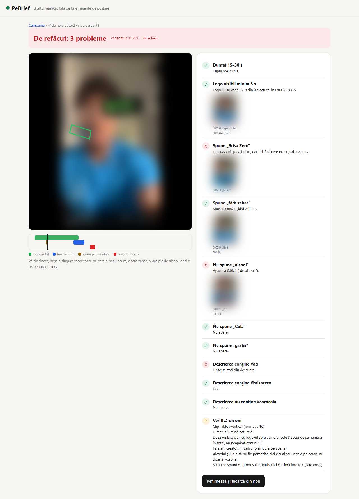
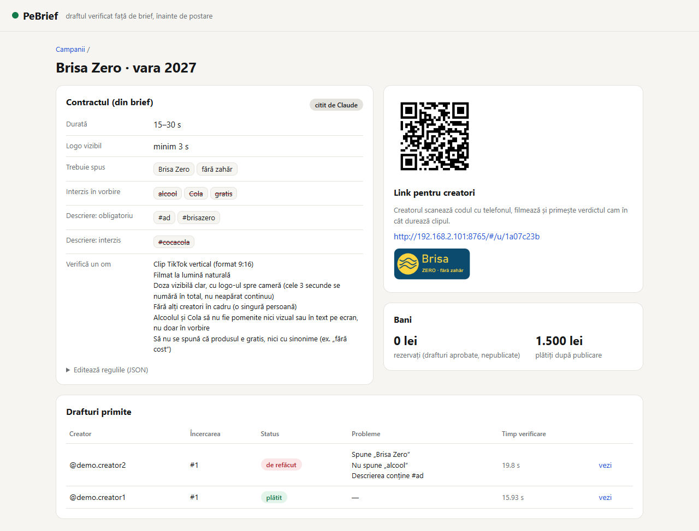
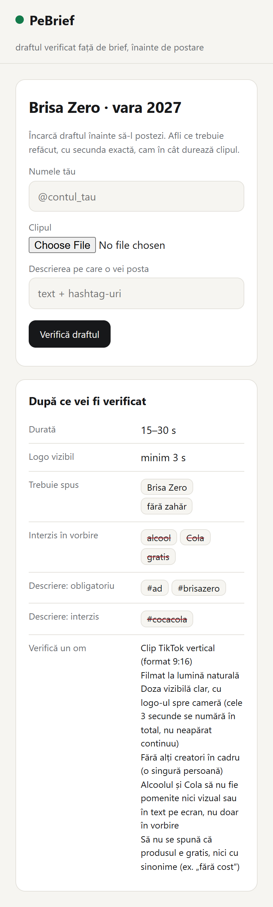

# PeBrief: draftul verificat față de brief, înainte de postare

**Problema.** O agenție care lucrează cu sute de creatori verifică fiecare draft de mână, față de brief: se vede logo-ul destul, s-a spus numele produsului exact, apare #ad, a scăpat vreun cuvânt interzis. Urmează runde de mesaje („logo-ul nu se vede”, „ba se vede”), orgolii și plăți întârziate. Campania Beach, Please! din aprilie 2026 a avut „sute de influenceri internaționali”.

**Ce face PeBrief.** Brief-ul devine un contract cu reguli verificabile. Creatorul încarcă draftul de pe telefon și primește, cam în cât durează clipul, un verdict cu **secunda exactă** și cadrul-dovadă: *„Logo-ul se vede 2,3 s din 3 s cerute, în 0:00.6–0:03.0”*, *„La 0:02.1 ai spus «Brisa», dar brief-ul cere exact «Brisa Zero»”*. Cu un cadru și o secundă în față, nu mai ai cu cine să te cerți. Când draftul trece, onorariul e rezervat și se eliberează la publicare.

Totul rulează local. Video-ul nu pleacă nicăieri. Doar textul brief-ului ajunge la Claude.

## Pornire

Cu Python 3.10 sau mai nou:

```
git clone https://github.com/marioalbu08/PeBrief
cd PeBrief
pip install -r requirements.txt
python server.py
```

- Pe laptop: http://localhost:8765
- Pe telefon (același Wi-Fi): adresa LAN afișată la pornire, sau codul QR din pagina campaniei.

Prima pornire descarcă modelul whisper `medium` (cam 1,5 GB), apoi îl ține în cache. Campania demo „Brisa Zero” se creează singură. ffmpeg vine prin `imageio-ffmpeg`, nu trebuie instalat separat. Fără Claude (fără `claude` în PATH și fără `ANTHROPIC_API_KEY`), brief-ul se citește cu parserul offline, pe șablon.

## Cum se folosește

1. **Agenția:** „Campanie nouă” → lipești brief-ul așa cum a venit, încarci logo-ul (sau poza produsului) → Claude scoate regulile. Ce nu se poate verifica automat (ton, lumină) ajunge la „Verifică un om”, nu e ignorat.
2. **Creatorul:** scanează QR-ul, filmează 15 s cu produsul, scrie descrierea → verdictul apare cu linia de timp: verde pentru logo, albastru pentru frazele cerute, roșu pentru cuvintele interzise. Click pe orice dovadă și video-ul sare la secunda respectivă. Peste video, un chenar verde urmărește logo-ul găsit.
3. Refilmează, reîncarcă, trece → „Am postat: eliberează plata” → registrul de bani se actualizează.



*În capturi, clipul e blurat: e un TikTok al altui creator, din setul de test.*

| Pagina campaniei | Creatorul, pe telefon |
| --- | --- |
|  |  |

## Cum funcționează

| Verificare | Metoda | Fișier |
| --- | --- | --- |
| Brief → reguli | Claude (`claude -p`, sau API dacă există `ANTHROPIC_API_KEY`); parser offline pentru șablon | `core/rules.py` |
| Logo vizibil N secunde | SIFT pe logo, pe 3 scări și pe fundal deschis/închis → potrivire FLANN + raport Lowe → omografie RANSAC → filtru geometric (convex, nu turtit, nu minuscul) → **verificare fotometrică** (zona readusă în forma logo-ului, corelație ≥ 0,6 cu logo-ul), 4 cadre/s la rezoluție nativă, apoi intervale cu goluri umplute și detecții izolate slabe aruncate | `core/logo.py` |
| Fraze cerute / interzise | faster-whisper `medium` local, cu timp pe cuvânt, fără indiciu de vocabular → aliniere cuvânt cu cuvânt pe tokeni normalizați (fără diacritice, cifre → cuvinte), acceptă un cuvânt lipit sau despărțit; detectează și „spus pe jumătate”. Pentru cuvintele interzise: prag mai permisiv, forme flexionate („alcoolul”), cuvinte despărțite („alt col”) | `core/speech.py`, `core/textmatch.py` |
| Descriere | hashtag-uri ca tokeni întregi (#ad ≠ #adidas) | `core/textmatch.py` |
| Durată | metadatele clipului | `core/check.py` |

## Cât de bine merge: măsurat

Detaliile sunt în `eval/REZULTATE.md`.

| | Reglaj (40) | Nevăzut (30) | Final, cod înghețat (30) |
| --- | --- | --- | --- |
| Verdict complet corect (9 verificări/clip) | 40/40 | 27/30 | 27/30 |
| **Clipuri aprobate deși nu trebuiau** | **0** | **0** | **0** |
| Eroare mediană la secundele de logo | 0,08 s | 0,11 s | 0,08 s |
| Timp pe CPU | ~1,1 s per secundă de video | | |

Re-rulat pe 26 noiembrie 2026, cu codul de acum, pe același set final: 28/30 verdicte complet corecte, 0 clipuri aprobate greșit, eroare mediană la logo 0,08 s. Un clip în plus iese corect față de rularea cu codul înghețat datorită reparației la logo făcute după ea, deci cifra asta nu mai e complet „nevăzută”. Cele două greșeli rămase sunt „Brisa Zero” picat pe nedrept.

Toate greșelile rămase sunt în direcția sigură: o verificare picată pe nedrept, cu secunda arătată, nu un clip greșit aprobat. Cele mai mari câștiguri au venit din măsurători: indiciul de vocabular pentru whisper producea halucinații („Brisa Zero” auzit de trei ori când creatorul spusese doar „Brisa”), iar potrivirea pe șir lipit aproba „brisa, e…” drept „Brisa Zero”. Ambele sunt scoase acum.

Pe scurt, despre setul de test: setul de test are clipuri TikTok reale de creatori, cu logo-ul inventat „Brisa Zero” pus peste ca un produs ținut în mână (perspectivă, rotație, blur, lumină, tremur), un logo-capcană „VOLTA” și voce românească TTS peste sunetul original în engleză. Adevărul e cunoscut cadru cu cadru.

**Clipurile nu sunt în repo,** pentru că sunt TikTok-urile altor creatori. Ca să refaci setul, pui clipuri verticale de-ale tale în `eval/data/bg/` (`.mp4`) și rulezi:

```
python eval/make_dataset.py 40              # setul de reglaj
python eval/make_dataset.py 30 --holdout    # setul nevăzut (alte fraze, alt seed)
python eval/make_dataset.py 30 --final      # setul final, rulat o singură dată
python eval/run_eval.py [--holdout | --final] [--hint]
python -m pytest tests                      # testele rapide, fără video
```

## Limite, spuse direct

- **Logo-ul din test e lipit digital**, nu filmat pe o doză reală. Pe o doză curbată, cu reflexii, recunoașterea va fi mai slabă. Următorul test: 20 de clipuri filmate de noi cu un produs real.
- **Vocea din test e TTS**, nu un creator care vorbește repede, cu argou și muzică tare.
- **SIFT recunoaște un logo plat.** Un logo pe o suprafață foarte curbată sau aproape fără textură (doar un cuvânt subțire) iese mai prost.
- **Plata e un registru simulat**, nu bani adevărați. Verificarea că postarea mai e online după 7 zile nu e făcută (ar cere API-urile TikTok/IG).
- **Viteza:** ~1 s de procesare pe secundă de video pe CPU (i7-9750H). Pe un server cu GPU, whisper ar merge de câteva ori mai repede.
